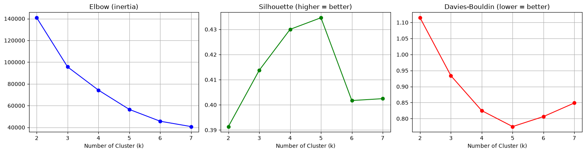
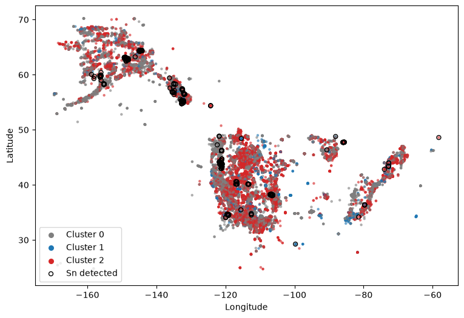

# Spatial-Geochemical Data Mining with the USGS NGDB

Data Mining Capstone project (University of Colorado Boulder, via Coursera).
Unsupervised clustering of major-oxide geochemistry from the USGS National Geochemical Database (NGDB), with an independent tin (Sn) check and spatial mapping.

## What this project does

1. **Cleans** the raw NGDB file (414,304 rows × 269 columns): removes invalid coordinates (e.g. latitude down to −113.8°), restricts the study area to North America (24–72°N, 170–50°W), and keeps samples with complete SiO₂, Al₂O₃ and MgO XRF values → **68,126 samples**.
2. **Clusters** the standardized oxides with K-Means (`k = 3`, k-means++, `n_init = 10`, `random_state = 42`). Latitude/longitude are *not* features; they are only used to map the result.
3. **Selects and checks k** with the elbow method, silhouette coefficient and Davies–Bouldin index (k = 2–7), plus a k = 5 sensitivity run.
4. **Validates independently with tin.** Sn is not a model input. Detection rates (no `<`/`L` qualifier) are compared across clusters with a chi-square test.
5. **Maps** the clusters (static plots and an interactive Folium map).

## Key results (from the notebook output)

| Cluster | n | Reading | Sn detection (Sn-measured samples) |
|---|---|---|---|
| 0 | 34,725 | Intermediate | 250 / 2,276 (11.0%) |
| 1 | 4,823 | Low SiO₂, high MgO | 10 / 53 (18.9%, too few to interpret) |
| 2 | 28,578 | Silica-rich (felsic) | 408 / 758 (53.8%) |

- Silhouette (k = 3): **0.414**; Davies–Bouldin: **0.934**. k = 5 scores only slightly better (0.435 / 0.775), so k = 3 was chosen because it yields three groups that can be interpreted geochemically (felsic, intermediate, and low-SiO₂/high-MgO).
- Sn vs. cluster: χ² = 615.73, df = 2, p ≈ 2×10⁻¹³⁴.
- The clusters are spatially interleaved; they do not form latitude bands.




## Limitations (short version)

Moderate cluster quality; mixed sample media and survey eras in the NGDB; oxides are compositional data (no log-ratio transform applied); tin is measured for only 4.5% of samples, mostly at the 2 ppm reporting limit, so the tin check is partial and may be biased; no deposit labels for ground-truthing. DBSCAN and Isolation Forest from the original proposal were not carried out.

## Repository layout

```
Project_Capstone.ipynb   # full analysis with outputs
figures/                 # figures exported from the notebook
data/                    # put the dataset here (not included, see data/README.md)
requirements.txt
```

## How to run

```bash
pip install -r requirements.txt
# place NGDB_merged_clean.csv in data/ (see data/README.md)
jupyter notebook Project_Capstone.Data Mining.ipynb
```

## Data

The dataset is **not** redistributed here. See [`data/README.md`](data/README.md).

## AI use disclosure

An AI assistant (Anthropic's Claude) was used to audit the earlier project reports against the notebook output, to suggest analysis changes (coordinate validation, Davies–Bouldin index, k comparison, handling of censored tin values), and to help draft and proofread the report. The code was run by the author on the original dataset.

## Author

Muhammad Azka Surya Athallah
